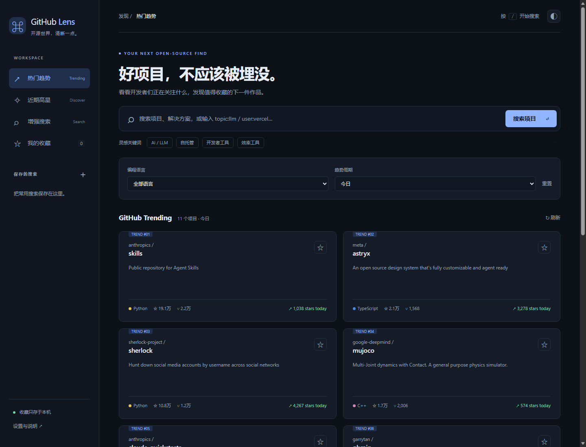

# GitHub Lens · 开源发现与增强搜索

一个独立的 Chrome Manifest V3 扩展。点击工具栏图标，打开全页式中文开源探索面板。无框架、无构建步骤、无第三方依赖。

## 下载与预览

从 [GitHub Releases](https://github.com/BiangBiangNan/github-lens/releases/latest) 下载 `github-lens-v1.0.0.zip`。也可以克隆本仓库，直接加载源码目录。



## 安装（开发者模式）

1. 将 `github-lens-v1.0.0.zip` 解压到一个固定位置，不要直接打开 ZIP 中的 HTML。
2. 在 Chrome 地址栏打开 `chrome://extensions/`。
3. 打开右上角的 **开发者模式**。
4. 点击 **加载已解压的扩展程序**，选择含有 `manifest.json` 的 `github-lens` 文件夹。
5. 点击 Chrome 工具栏的拼图图标，将 **GitHub Lens** 固定，再点击它打开面板。

源码文件夹也可以直接按上述方式加载。修改源码后，在扩展管理页点击重新加载，并刷新已经打开的面板。

这是开发者模式安装包，不是经过 Chrome 应用商店审核的 CRX。不能通过拖入 ZIP 一键安装。Chrome、Edge（`edge://extensions/`）均使用 Chromium 扩展接口；以实际安装测试为准。

## 功能

- **热门趋势**：读取 GitHub Trending 的日 / 周 / 月榜单，支持语言筛选。显示仓库简介、语言、Star、Fork 和榜单提供的涨星信息。
- **近期高星**：搜索最近 30 天创建、至少 100 Star 的仓库，按总 Star 排序。它不是实时涨星榜，也不是 Trending 的替代数据。
- **增强搜索**：关键词 + 语言 + 最低 Star + 最近更新时间 + 许可证 + 排序；默认排除归档及 Fork。
- **高级语法**：关键词可以直接输入 `topic:llm`、`user:vercel`、`in:readme` 等 GitHub 限定词；生成的查询可在面板查看，并在 GitHub 打开。
- **搜索预设**：AI/LLM、自托管、开发工具、效率工具；支持自定义保存最多 100 个常用搜索。
- **本地收藏**：收藏不等于 GitHub Star，不会操作 GitHub 账号。收藏是添加时的仓库信息快照，不保证实时更新。
- **数据备份**：在「设置与说明」导出 / 导入 JSON，导入采用合并方式。
- **体验**：暗色 / 浅色主题、键盘 `/` 聚焦搜索、加载和错误状态、分页。

### 搜索示例

- AI 项目：输入 `topic:llm`，语言选 Python，最低 Star 选 1,000+，更新选 30 天内。
- 自托管工具：输入 `topic:self-hosted`，按 Star 排序。
- 找某个组织的项目：输入 `org:vercel`。
- 精确关键词：输入 `"vector database" in:description`。

筛选改变后，点击 **搜索项目** 才发起搜索，避免每次选项变化都消耗 API 额度。Trending / 近期高星的语言和周期变化会即时请求。高级语法与控件若设置了相互冲突的条件，可能没有结果；可将对应控件重置后只使用高级语法。

## 数据来源与限制

- 仓库搜索：`https://api.github.com/search/repositories`，公开未认证 REST API。
- 趋势榜单：`https://github.com/trending`，通过扩展后台获取 HTML，然后只提取结构化文本和安全仓库路径；不执行远程页面脚本。
- 搜索接口通常约 **10 次 / 分钟**，公开 API 通常还受 **60 次 / 小时**总额度影响，具体以 GitHub 返回的限流状态为准。同一公网 IP 的使用者可能共用额度。
- 默认不需要 Token，本版不支持 Token 输入，也不搜索私有仓库。请求超时或被限流会提示，不会用假数据填充。
- 搜索最多浏览 GitHub API 允许的前 1,000 个匹配项（每页 30 条，界面最多 33 页，即 990 条）；不能绕过官方搜索结果上限。
- 搜索及趋势响应使用后台内存缓存，有效期 5 分钟，最多 60 条。点击刷新清理缓存。后台 service worker 休眠后缓存可能丢失。
- Trending 没有官方稳定 REST 接口，GitHub 页面结构变化可能导致解析失败；失败时提供直达链接，不会偷偷换成普通 Star 排序。
- 没有离线仓库搜索。网络不可用时仍可查看收藏，但新搜索和榜单需要联网。

## 权限与隐私

只有 `storage` 以及 GitHub / GitHub API 两个站点的访问权限：

- `storage`：本机收藏、保存的搜索、主题。
- `api.github.com`：公开仓库搜索。
- `github.com`：读取 Trending。

无内容脚本、无浏览记录读取、无分析追踪、不修改网页、不请求登录、不写 GitHub Star、不读取账号 Cookie。请求采用 `credentials: omit`。搜索词作为 GitHub 查询发送给 GitHub；不会发送给扩展开发者或其他服务器。

收藏和保存的搜索存于 `chrome.storage.local`，不是云同步。卸载扩展可能删除这些数据，请提前导出备份。收藏、保存搜索和备份合并通过后台队列串行写入，避免多面板操作互相覆盖。备份请勿存入不可信位置。

## 源码结构

- `manifest.json`：MV3 清单及权限 / CSP。
- `background.js`：固定来源网络请求、参数校验、缓存、限流错误处理、打开 / 聚焦面板。
- `core.mjs`：查询构建、安全 URL、数据规范化、展示格式函数。
- `dashboard.html` / `styles.css` / `dashboard.js`：中文 UI、榜单解析、本地数据及交互。
- `icons/`：本地生成的 PNG 扩展图标。
- `tests/`：无第三方依赖的自动化测试。

运行核心测试：

```shell
node --test tests/core.test.mjs
node --test tests/background.test.mjs
```

具体结果和未覆盖范围见 `TESTING.md`。`tests/browser-check.mjs` 是 Windows / Edge 专用的无头集成测试，需要较新的 Node（内置 WebSocket）；它会使用工作区旁的隔离测试配置，不使用你现有的 Chrome 配置。`tests/network-check.mjs` 需要联网，会消耗少量 GitHub API 额度。`tests/package_extension.py` 需要 Python 和 Pillow，用于重新生成图标并打包。使用扩展本身不需要安装 Node、Python 或这些依赖。

## 后续适合扩展的方向

可选的细粒度 Token（需专门设计安全存储）、跨设备同步、README 预览、自然语言搜索、本地自建涨星历史、Chrome 商店发布。本版本没有承诺这些尚未实现的能力。
